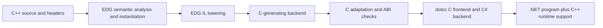

# Feasibility: C++ → EDG C output → dotcc → C#

Assessment: **feasible for a constrained subset; not a drop-in general C++
frontend for dotcc.** A templates/lambda/member-function program runs end to
end after small C syntax adaptations. General application support needs an
explicit ABI contract, C dialect work, a C++ runtime implementation, and
startup/linking integration. Merely obtaining compilable C# is insufficient:
the probes include a program that compiles successfully and returns the wrong
result because the physical object layout differs.

Test date: 2026-10-01. EDG revision
`89e67e07c7f6d0fc38622f9778d8e79f40deaa0f`; dotcc revision
`6b6f1305ae08224b479135f4c3bc45851febcd16`, with pre-existing documentation
changes. No dotcc implementation changes were made. Build configuration and
reproduction commands are in [the build report](../README.md).

## What EDG supplies



EDG resolves C++ names, overloads, templates and constant expressions, then
lowers classes, references, constructors/destructors, virtual dispatch and
other features to C-level operations. This is the useful part of the proposal:
dotcc would not need to implement a C++ parser and semantic analyzer.

The C backend is real, but upstream describes it as a testing/portability
backend. Its output depends on configuration and the downstream C compiler.
Our GCC-hosted profile emits GNU C constructs, not only ISO C. The bundled
runtime handles language support; it is not a complete C++ standard library.
See upstream [IL lowering](https://github.com/edgcpp/compiler/blob/89e67e07c7f6d0fc38622f9778d8e79f40deaa0f/doc/source/lower_il.rst),
[C generation](https://github.com/edgcpp/compiler/blob/89e67e07c7f6d0fc38622f9778d8e79f40deaa0f/doc/source/c_gen_be.rst), and
[runtime documentation](https://github.com/edgcpp/compiler/blob/89e67e07c7f6d0fc38622f9778d8e79f40deaa0f/doc/source/runtime.rst).

## Measured results

`probe.py` compares original C++ under GCC, EDG's native driver, the exact
generated C compiled with GCC plus EDG's runtime, raw C through dotcc, and
normalized C through dotcc. Every successful C# emission is built; every
successful build is executed. EDG's minimal inliner is disabled for the
examined C output so it does not erase the operations being investigated.

Normalization only removes numeric line directives, removes the C `auto`
storage class, spells `__inline__` as `inline`, and removes EDG's exact
`__asm__(".align 2");` directive. **Weak attributes are preserved.** This
small regex adaptation is an experiment over the provided fixtures, not a
production transformation. Dropping function alignment may invalidate native
member-pointer representations and must not become a general policy.

| Probe | Native C++ and exact generated C | Normalized C → C# | With exceptions and RTTI disabled |
|---|---|---|---|
| `arithmetic` — template, captured lambda, member call | Pass | Build and execution pass | Pass |
| `empty` — unused empty object and folded size | Pass | Pass, but object storage is eliminated | Pass; does not validate empty-object layout |
| `lifetime` — nonempty object, constructor/destructor effects | Pass | Union-forward-declaration parse failure in EH support | Build and execution pass |
| `allocation` — new/delete | Pass | Union-forward-declaration parse failure in EH support | Emits C#; build fails on `_Znwm` and `_ZdlPvm` |
| `exceptions` — throw/catch plus destructor on unwind | Pass | Union-forward-declaration parse failure | Not attempted: would remove the feature being tested |
| `globals` — dynamic global initialization before main | Pass | Unsupported `__constructor__` attribute | Same |
| `thread_local` — dynamic TLS initialization | Pass | Assembler alias directives not accepted | Same |
| `virtual` — virtual call through base reference | Pass | Weak attributed vtable array declaration not accepted | Same |
| `rtti` — dynamic_cast plus virtual destructor | Pass | Union-forward-declaration parse failure | EDG correctly rejects dynamic_cast with RTTI disabled |
| `layout` — actual long-double member address vs EDG layout | Pass | Builds, then **fails** (exit 1) | Same |
| `vector` — std::vector with bundled header configuration | GCC passes; EDG cannot find `<vector>` | Not reached | Not reached |

Raw output fails at numeric `#` line markers in all ten header-free probes.
The table records the first blocker, not every blocker behind it. These
counts do not measure C++ conformance, and none of the passing rows establishes
multi-translation-unit or NativeAOT correctness.

The separate `--system-vector` experiment configures GCC 13's C++ headers and
GNU emulation. The serialized-IL path crashes with
`read_memory_region: not all expected entries were read`. Passing
`--set_flag skip_il_read` makes EDG's native build and execution succeed, and
C generation succeeds. Normalized C still fails in dotcc at a forward union
declaration. This distinguishes header configuration and an upstream IL issue
from downstream compatibility. It does not establish general libstdc++ support.

Full stage codes are in [the matrix](../evidence/probes.json) and
[system-vector result](../evidence/vector-system.json). Source inputs are in
[probes/](../probes); generated files and logs are in `../artifacts/probes/`.

## Blocking issues and their consequences

### 1. Make the frontend and managed target agree on layout

EDG has already committed to sizes, alignments, base offsets, vtable formats,
allocation sizes and array strides before C emission. Some become integer
constants; a second compiler cannot recover the original intent from them.

The tested source contains:

```cpp
struct Value { char c; long double n; };
```

For the selected native ABI, the size is 32 and `n` starts at offset 16.
The generated C contains folded size comparisons. dotcc emits a C# struct
with a `byte` followed by a `double`, whose second field is at offset 8.
The final probe computes the offset from actual addresses and fails. A prior
size-only form passed because EDG had folded the comparisons to true.

Therefore require one explicit target profile shared by EDG, dotcc and the
runtime. Either model the native ABI faithfully in dotcc, including extended
floating point, or configure EDG to the managed target's supported layout and
reject incompatible external binaries. Changing only C type spellings cannot
repair already-folded constants. Validate `sizeof`, `alignof`, field/base
offsets, pointer width, signed char, enums, packing, bitfields, wchar_t,
long double, atomics and over-alignment. Check actual storage and arrays as
well as compiler constants. See [`targ_def.h`](../upstream/src/targ_def.h),
[`layout.c`](../upstream/src/layout.c), and dotcc's
[layout implementation](../../DotCC.Lib/Ir/IrBuilder.Layout.cs).

### 2. Define a supported C output dialect

Fix numeric line markers, `auto` storage declarations, GNU inline spellings,
union forward declarations, empty record representations, and attribute
placement where needed. Preserve source mapping instead of discarding it.
Prefer an EDG configuration/emitter adaptation over unbounded textual rewrites.
`GCC_IS_GENERATED_CODE_TARGET=0` with a carefully configured ANSI C profile is
a candidate, not a tested solution: replacing GCC-specific startup and
linkage behavior still requires explicit implementations.

dotcc already implements weak **functions**. The observed vtable failure is
for weak **data**, so reporting all weak symbols as unsupported would be
incorrect. C++ inline variables, template statics, vtables and RTTI need
consistent COMDAT/ODR handling and address identity across translation units.
See [weak function handling](../../DotCC.Lib/Ir/IrBuilder.WeakFunctions.cs) and
the [grammar](../../DotCC.Lib/c.lalr.yaml).

### 3. Supply the language runtime

Lowering `new Value(42)` generates `_Znwm`; sized delete generates `_ZdlPvm`.
Those names are unresolved in the generated managed program. A first supported
subset can provide a C/managed runtime bridge for allocation, sized/aligned
delete, array cookies, construction/destruction loops, pure-virtual failure,
static guards and termination. Allocation failure, new-handler behavior and
constructor failure cleanup must be part of its contract.

The supplied `libC.a` is native machine code and does not become managed C# by
linking its name into the project. Options are translating the relevant
`lib_src` sources too, implementing equivalent managed helpers, or explicitly
using native interop. Native interop makes the result depend on native binaries
and does not make native C++ unwinding through managed frames work.

### 4. Exceptions require a designed runtime integration

The C backend requires full portable EH lowering. The observed output contains
`_setjmp(long[25])`, `__throw_setup`, `__throw`, an EH stack, region tables and
destructor callbacks. EDG's documentation explicitly distinguishes this
exception runtime from ABI-conforming native Itanium exception handling.

dotcc recognizes calls named `setjmp` and implements selected control-flow
forms using managed exceptions. Its runtime does not implement EDG's EH
protocol. Renaming `_setjmp` alone would not address buffer representation,
thread state, typed catch selection, rethrow, exception-object ownership,
cleanup callback signatures, nested unwinding or `noexcept` termination.
Native `longjmp` must not jump through managed execution frames.

For this C route, port the complete relevant EDG portable EH protocol onto
managed execution and validate its generated control-flow shapes. Disabling
exceptions is a useful initial product restriction, not general support for
C++ code that uses them. Sources: [`lower_eh.c`](../upstream/src/lower_eh.c),
[dotcc setjmp recognition](../../DotCC.Lib/Ir/IrBuilder.cs),
[managed setjmp runtime](../../DotCC.Libc/SetJmpLib.cs).

### 5. Startup, TLS, calls and linking are semantic work

Global objects need initialization before their first required use and
destruction in the correct reverse order. The probe emits a GNU constructor
attribute that dotcc rejects. TLS emits assembler aliases from `_ZTH5value`
to `__tls_init`; simply stripping the assembler loses behavior. Supply an
initialization manifest, static guards, shutdown registration, and per-thread
initialization/destruction.

Vtables in this profile store function addresses in integer-sized slots and
cast them back to function pointers. dotcc has pointer/callback machinery,
but this particular representation, pointer adjustments, thunks and native
versus managed calling conventions must be validated. Do not infer success
from basic C function-pointer support.

EDG also has a prelinker for automatic template instantiation. `--instantiate
used` is adequate for the isolated tests, not a whole-program link policy.
Choose per-TU instantiation and deduplication or integrate its prelink flow;
verify cross-TU static identity, exported functions and initialization order.

### 6. Headers and libraries remain a separate compatibility problem

The frontend needs the target's actual macro/include environment, not an
accidental mix of host glibc/libstdc++ layouts and synthetic managed headers.
Header-only templates still instantiate code that calls runtime libraries.
Strings, iostreams, locale, filesystem, exceptions and threading bring external
symbols and platform assumptions. Choose a library implementation and a port
strategy; the small vector success under the native driver is not evidence
that those libraries run on .NET.

Inline assembler, platform intrinsics, vectors, UPC, Embedded C address spaces,
C++/CLI and C++/CX each require a target implementation or a diagnostic.
“Frontend accepts it” is not “C# can execute it.”

## Recommended implementation sequence

1. **ABI and dialect gate.** Freeze a target contract and build layout oracles.
   Add semantic handling for observed C forms and source mapping. Reject
   unmodeled types/features before generating an executable.
2. **Useful bounded subset.** Arithmetic, templates, lambdas, aggregates,
   deterministic normal-path destruction and a small allocation runtime;
   exceptions and unsupported native libraries excluded explicitly. Run
   arithmetic and lifetime fixtures unchanged, without regex adaptation.
3. **Object/runtime completeness.** Multiple and virtual inheritance, RTTI,
   member pointers, new/delete arrays, static/TLS lifetimes and multi-TU ODR
   identity. Test callbacks and layout under GC pressure and NativeAOT.
4. **Exceptions and libraries.** Implement/translate the EH runtime and select
   a real standard-library workload. Differentially test failures and cleanup,
   not just successful control flow.

A sensible go/no-go milestone is a real, dependency-light C++ library with
templates and owned objects, compiled unchanged to native and managed
executables with matching outputs and layout assertions. The current evidence
justifies that pilot. It does not justify promising arbitrary C++ → C#.
