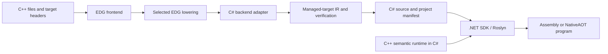

# Feasibility: an independent C# backend for EDG

The [dot_gen_be.c implementation plan](dot-gen-be-plan.md) records the agreed
direction and detailed delivery gates: unsafe C#, lifetime-based CLR cleanup,
runtime platform selection, reusable libc, translated libc++ and NativeAOT.
Use that plan for implementation; this document retains the feasibility study.

Assessment: **technically feasible as a substantial compiler/backend and
runtime project.** EDG already provides the difficult C++ frontend and a
configurable lowering layer. A new backend can consume that internal
representation and emit unsafe C#. The most practical starting point retains
EDG's lowering of templates and object operations while preserving exception
and lifetime information for managed code generation.

This design is a standalone EDG-derived compiler. Its backend, target model,
build driver, generated program support and runtime are its own components.
No C translation stage or external C-to-C# compiler is required. No direct C#
backend was implemented in this investigation; recommendations below are
design proposals based on source inspection and a working EDG native build.

Evidence is pinned to EDG 7.0 revision
`89e67e07c7f6d0fc38622f9778d8e79f40deaa0f`, tested on 2026-10-01. The
[build report](../README.md) records tools, configuration and limitations.

## The available integration points

EDG's “IL” is its own C/C++ intermediate representation, **not .NET CIL**.
It contains typed expressions and structured statements together with types,
routines, variables, labels, source information and C++ semantic metadata.
Lowering can turn C++ constructs into C-level operations without flattening
everything to machine instructions.

| Source component | Role in a new backend |
|---|---|
| [`src/cfe.c`](../upstream/src/cfe.c) | Frontend driver calls `back_end()` after frontend wrapup when configured to do so. |
| [`src/c_gen_be.c`](../upstream/src/c_gen_be.c) | Reference implementation for traversing lowered IL, declarations, expressions and function memory regions. |
| [`src/cp_gen_be.c`](../upstream/src/cp_gen_be.c) | Reference for emitting higher-level C++ constructs when starting above lowering. It is a C++ emitter, not a CLR emitter. |
| [`src/il_def.h`](../upstream/src/il_def.h), [`src/il_walk.c`](../upstream/src/il_walk.c) | IR structure and traversal utilities. |
| [`src/lower_il.c`](../upstream/src/lower_il.c), [`lower_init.c`](../upstream/src/lower_init.c), [`lower_name.c`](../upstream/src/lower_name.c) | Existing object, initialization and symbol-name lowering. |
| [`src/lower_eh.c`](../upstream/src/lower_eh.c) | Explicitly supports three exception-lowering levels, including retaining exception constructs. |
| [`src/targ_def.h`](../upstream/src/targ_def.h), [`target.c`](../upstream/src/target.c), [`layout.c`](../upstream/src/layout.c) | ABI, layout, runtime and backend configuration. |
| [`src/il_read.c`](../upstream/src/il_read.c), [`il_write.c`](../upstream/src/il_write.c), `cdisp` | Serialized IL and inspection for development. |
| [`lib_src/`](../upstream/lib_src) | Sample language runtime and a specification-by-implementation for runtime contracts. |

The built `cpfe` lowers and runs native examples using constructors,
destructors, virtual calls, RTTI, exceptions and dynamic initialization.
`cpfe-cp` also regenerated the arithmetic/template example, which GCC compiled
and ran. `cdisp` read its lowered IL. These observations demonstrate usable
frontend/backend interfaces, not the correctness of a future managed backend.

Primary references: [IL model](https://github.com/edgcpp/compiler/blob/89e67e07c7f6d0fc38622f9778d8e79f40deaa0f/doc/source/il.rst),
[lowering design](https://github.com/edgcpp/compiler/blob/89e67e07c7f6d0fc38622f9778d8e79f40deaa0f/doc/source/lower_il.rst), and
[C backend design](https://github.com/edgcpp/compiler/blob/89e67e07c7f6d0fc38622f9778d8e79f40deaa0f/doc/source/c_gen_be.rst).

## Choose a lowering boundary deliberately

| Approach | Advantage | Cost / limitation |
|---|---|---|
| Fully lowered C-like IL, including portable EH | Reuses the most existing lowering; smallest initial expression/statement surface | Inherits native ABI-shaped runtime calls, setjmp-based EH tables and callbacks that are awkward in managed execution |
| **Object lowering with structured EH/lifetime information retained** | Reuses class/template lowering while allowing managed exceptions and explicit cleanup | Requires new emission for remaining EH nodes, lifetime transitions and runtime services; recommended path |
| Unlowered C++ IL → mostly idiomatic C# | Rich names, class and ownership information for a higher-level translation | Must implement C++ object/lifetime semantics itself; substantially larger project |

The middle choice has explicit support in `lower_eh.c`, rather than requiring
reconstruction of `try`/`catch` from generated C. An initial candidate backend
configuration is:

```c
BACK_END_IS_C_GEN_BE=0
BACK_END_IS_CP_GEN_BE=0
BACK_END_SHOULD_BE_CALLED=1
DO_IL_LOWERING=1
DO_FULL_PORTABLE_EH_LOWERING=0
GENERATE_EH_TABLES=0
KEEP_OBJECT_LIFETIME_INFO_IN_LOWERED_IL_WHEN_EH_ENABLED=1
IL_SHOULD_BE_WRITTEN_TO_FILE=0
```

This is a **proposed starting configuration**, not a validated complete build
profile. It needs a new backend target, the `back_end()` implementation,
initialization/cleanup integration, a coherent target ABI and reviewed values
for other dependent switches. The source describes retained `try`/`catch`,
`throw`, lifetime information and `enk_lowered_eh_construct` nodes in this mode.
The existing C emitter cannot simply run in it: that emitter requires full
portable EH lowering.

## Proposed standalone architecture



Start with a C++ backend compiled alongside EDG. Traverse native IL using
upstream structures, then create a small owned IR for target emission. That
IR should make sequencing, temporary lifetimes, control flow, storage,
initialization order, calling conventions and exceptional edges explicit.
Emit C# from that representation with exhaustive diagnostics for unsupported
nodes. This avoids scattering C# restrictions through semantic analysis.

EDG manages function bodies in separate memory regions, and lowering occurs
as regions end. A backend must load the appropriate regions and copy data it
needs before their lifetime ends. Follow the C backend's
`mem_region_for_routine`/`read_memory_region` handling; do not retain raw
pointers after freeing the region. IL expressions also leave some evaluation
ordering to the backend, so a syntax printer alone is insufficient.

Keep an in-process integration initially. A separate managed emitter could
later consume an explicitly versioned serialized schema owned by this project.
The native EDG IL file should not be treated as a stable cross-version API or
read by guessing its binary structure. In the tested configuration, a vector
example hit an IL readback internal error that disappeared when readback was
skipped. This reinforces using native APIs and testing serialization separately.

## Target semantics and generated code

The first output should preserve C++ behavior with unsafe structs, explicit
storage and static methods. Source-like names can improve diagnostics, but
the compiler should not promise idiomatic C# class hierarchies.

For example, a C++ object with an integer field and a member function could
be represented conceptually as:

```csharp
[StructLayout(LayoutKind.Explicit, Size = 4)]
internal struct ValueStorage
{
    [FieldOffset(0)] public int n;
}

internal static unsafe int Value_Add(ValueStorage* self, int x)
    => self->n + x;
```

The snippet illustrates representation only; a complete emitter must derive
layout and arithmetic behavior from the selected target contract. Templates
become concrete instantiations, rather than being mechanically mapped to CLR
generics. C++ specialization, non-type template parameters and type-dependent
layout make that distinction necessary.

| C++ feature | Proposed managed implementation and required checks |
|---|---|
| Scalars and arithmetic | Define widths, signedness, promotion and overflow behavior; use explicit conversions and `unchecked` where appropriate. Extended floats need real implementations or rejection. |
| Structs, classes and unions | Unmanaged storage with explicit offsets or byte-backed accessors. Handle overlap, bitfields, base subobjects, empty bases and tail-padding reuse. CLR class inheritance does not model arbitrary C++ multiple inheritance. |
| Constructors, copy/move, assignment | Explicit generated operations on storage; do not replace nontrivial copy construction with C# struct assignment. Respect placement construction and object identity. |
| Destruction and temporaries | Emit deterministic cleanup on every normal/exceptional exit, including partial construction and return-value temporaries. CLR finalizers are not C++ destructors. |
| References and pointers | Use native pointers or verified `ref` forms where lifetimes allow. Escaping pointers need stable storage and explicit ownership. |
| Virtual dispatch and member pointers | Reuse EDG-computed adjustments/thunks; emit managed function-pointer tables or dispatch IDs. Preserve null/member-pointer representation, identity and base adjustments. |
| RTTI / dynamic_cast | Generate C++ type descriptors and an inheritance graph; implement cross-casts and pointer adjustments. CLR `is`/`as` alone cannot provide those semantics over unmanaged object storage. |
| new/delete and arrays | Managed runtime owns aligned unmanaged storage, cookies, overflow checks and destruction counts; handle allocation failure and new-handler rules. |
| Static/global objects | Build an initialization/destruction manifest; preserve required ordering, inline identity, once guards and recursive/error cases. CLR type initialization is not automatically an equivalent schedule. |
| thread_local | Per-thread storage, dynamic initialization guards and a destruction protocol. `[ThreadStatic]` alone does not implement nontrivial C++ TLS lifetime. |
| Exceptions | Managed exception carrier plus C++ payload/type identity, explicit catch matching and cleanup. Preserve rethrow, by-value catch copying, exception-object lifetime and `noexcept` termination. |
| Atomics / volatile | Implement the chosen C++ memory-model operations, including width/alignment and compare-exchange details; validate concurrency, not only single-thread results. |
| Coroutines | Use EDG's coroutine lowering as the starting point; verify frame ownership, suspension, destruction and allocation behavior. C# `async` is not an automatic equivalent. |
| Native interop | Generate adapters for explicit C ABI entry points, with distinct managed and native callback conventions. Do not promise direct compatibility with arbitrary native C++ objects or exceptions. |

C# supports unsafe pointers and function pointers, but pointers do not keep
managed storage alive or stationary. Pinning or nonmoving allocation must be
part of the runtime design. See Microsoft's
[unsafe-code reference](https://learn.microsoft.com/en-us/dotnet/csharp/language-reference/unsafe-code).
Native exports also have restrictions: `UnmanagedCallersOnly` methods are
static, use supported blittable parameters, and cannot be called directly
from managed code. Generate separate wrappers when necessary; see
[the attribute reference](https://learn.microsoft.com/en-us/dotnet/api/system.runtime.interopservices.unmanagedcallersonlyattribute?view=net-10.0).

An explicit struct size is not a guarantee of 16/32/64-byte alignment for every
local or allocation. Over-aligned objects need a verified storage strategy.
Choose between a managed-only ABI and compatibility with a specific native
ABI early. Configure EDG's layout and constant evaluation to that choice
before compiling input; emitted checks cannot undo previously folded sizes.

### Exception handling deserves its own design

EDG's portable runtime uses an EH stack, cleanup tables and setjmp/longjmp.
The recommended backend should instead consume the retained EH and lifetime
nodes and emit managed protected regions plus its own C++ exception runtime.

A managed carrier can own the thrown C++ object, its type descriptor and
destructor operation. Catch selection must model C++ matching and base
adjustments; cleanup must execute in C++ lifetime order. `throw;` must preserve
the active exception object, while catch-by-value may require a new copy.
If a destructor throws during unwinding, or an exception escapes `noexcept`,
the runtime must implement termination semantics.

Do not wrap every scope in `finally` indiscriminately. C# restricts control
flow across protected regions, and C++ cleanup eligibility depends on which
objects finished construction. Use explicit lifetime state and a CFG transform
where needed. Preserve return values across cleanup, and test failed
construction, nested handlers and rethrow. Native unwinding across managed
frames is outside this design; native boundaries must translate errors through
an explicit contract.

## What remains beyond the emitter

**A standard library port.** EDG's supplied headers and `lib_src` cover core
language support, not a full standard library. A standalone implementation
must choose compatible target headers and a libc/libstdc++/libc++ strategy.
Start with a small library surface; inventory every unresolved runtime call.
Header-only code is not necessarily runtime-independent. Streams, locale,
filesystem, threads and platform APIs are major follow-on work.

**A program builder/linker.** Merge translation-unit manifests, resolve
externals, instantiate/deduplicate templates and inline entities, maintain ODR
identity, assemble startup/shutdown order, and generate compilable projects.
EDG's prelinker provides a reference workflow; native object-file tooling is
not directly a managed assembly linker.

**A C# legality pass.** Handle pointer casts, address-taking, function-pointer
signatures, fixed storage, evaluation sequencing, local declaration scopes,
`goto` across scopes, protected-region rules and integer/enum conversions.
Preserve diagnostics and source mapping through `#line` or a source map.
Large template instantiations need splitting and size monitoring so generated
methods do not exceed practical CLR/Roslyn limits.

**An extension policy.** The built frontend has broad extension gates enabled,
including reflection. Compile-time features that disappear during semantic
analysis may require little runtime support. Inline assembly, compiler
intrinsics, address spaces, UPC and platform-specific attributes may require
new runtime semantics or rejection. C++/CLI/C++/CX parse support does not supply
a C# backend, metadata ecosystem or Windows SDK. Define diagnostics per feature
instead of claiming all accepted input can execute on .NET.

## Incremental delivery and acceptance gates

1. **Backend skeleton and target contract.** Add the independent CMake target,
   call `back_end()`, inspect representative IL, and emit compilable scalar
   functions with a generated project. Validate layout and sequencing before
   broadening types.
2. **Useful object subset.** Templates, lambdas, structs, nonvirtual methods,
   explicit construction/destruction and allocation. Include multi-TU manifests
   and deterministic generated names. Build and execute native/managed pairs.
3. **Object-model completeness.** Multiple/virtual inheritance, member pointers,
   RTTI, static/TLS initialization, arrays and over-alignment. Establish storage
   and callback correctness under forced GC, threads and NativeAOT.
4. **Managed EH.** Implement the retained EH node set and semantic runtime;
   test partial construction, cleanup order, rethrow, catch matching and
   termination paths against a native oracle.
5. **A selected real library.** Port a bounded standard-library/runtime surface,
   translate a substantive project unchanged, and measure performance,
   generated size, build time and failure diagnostics.

The first stage is an exploratory prototype; the full sequence is a
multi-month or larger compiler effort, depending heavily on the chosen
language/library boundary. General native-C++ compatibility is an open-ended
objective and should not be represented as a short backend-printing task.

Success means matching observable behavior and storage contracts, including
failure paths, not just getting Roslyn to accept generated text. EDG's native
runtime and upstream tests provide useful differential oracles. A release
would need a selected upstream test corpus in addition to focused managed
target tests; this investigation did not run EDG's complete test suite.

## Recommendation

Build a standalone unsafe C# backend at the selectively lowered IL boundary.
Keep a managed-only target contract initially, support a clearly defined
subset, and design object lifetime and exceptions before adding large library
workloads. Keep public managed facades as a later layer over faithful generated
storage. This uses EDG's semantic work effectively while avoiding an early
promise that all C++ classes naturally become C# classes.

The upstream source declares
[Apache-2.0 WITH LLVM-exception](https://github.com/edgcpp/compiler/blob/89e67e07c7f6d0fc38622f9778d8e79f40deaa0f/LICENSE.txt).
Maintain the upstream/compiler-runtime attribution and a clear inventory of
any additional standard-library sources used by the standalone project.
