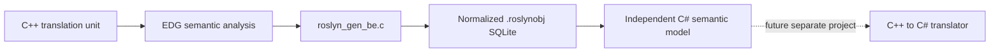

# EDG semantic tree and `.roslynobj`: design for approval

Status: phases 1–2, analysis and proposed contract only. Implementation has not
started. This design requires user approval before phases 3–4.

## Scope and authority

Create a new EDG backend, `roslyn_gen_be.c`, that serializes the semantic
representation of one translation unit into normalized SQLite, and an independent
C# library that reads it. The eventual C++-to-C# translator is a separate future
project; neither the backend nor the model emits C# in these phases.

EDG alone decides C++ semantics. The backend projects its decisions; the reader
loads them. Neither repeats name lookup, overload resolution, template selection,
constant evaluation, layout, or lifetime analysis. Mechanical representation
changes, database identities, and traversing EDG-provided relationships are allowed.

The investigation uses a fresh checkout of upstream
[`edgcpp/compiler@89e67e07c7f6d0fc38622f9778d8e79f40deaa0f`](https://github.com/edgcpp/compiler/tree/89e67e07c7f6d0fc38622f9778d8e79f40deaa0f),
the revision recorded by `../upstream-origin.json`. Its `src/version.h` identifies
EDG 7.0. Existing custom backends, serialized-object efforts, their designs,
findings, tests, and artifacts were excluded. Existing worktree modifications
are neither changed nor used as semantic evidence. Upstream source citations in
the companion documents refer to this pinned revision, not modified local files.

## Decisions proposed for approval

1. Export EDG's semantically elaborated C++ IL with optional general IL lowering
   disabled. This is not an unresolved parser tree: selected routines, instantiated
   bodies, implicit conversions, range-for expansion components, initialization,
   and lifetime records already exist. Preserve structured C++ operations and
   their EDG-selected semantic components together.
2. Preserve native exception constructs. Do not generate setjmp/longjmp,
   exception runtime tables, C-shaped class representations, or coroutine state
   machines for this format.
3. Store a typed semantic graph with a source-shaped traversal view, not a clone
   of every EDG allocation. Declaration occurrences, symbols, types, operations,
   initialization, and lifetimes have separate identities and relationships.
4. Keep every retained executable definition and every retained declaration/type
   definition in the translation unit, including header entities and unused
   definitions. Add their transitive semantic dependencies. Do not prune using
   a guessed future program entry point or only EDG's code-emission flags.
5. Keep template definitions/origins and concrete instantiations distinct.
   Dependent patterns are not execution-ready instantiations. Do not force EDG
   to instantiate unused templates just to make a database look complete.
6. Use only normalized scalar/foreign-key columns and ordered child rows.
   Intern names and literal values; never merge entities merely because their
   spelling or value matches. No JSON, BLOB semantic payloads, binary structs,
   encoded struct dumps, or lists packed into text columns.
7. Provide an immutable Roslyn-inspired C# API with no Microsoft.CodeAnalysis
   dependency. Multiple objects may be open at once, but identities and semantic
   queries remain translation-unit-local. Cross-unit linking/deduplication is
   deferred.
8. Retain EDG source positions and available macro records by default. Full token
   tapes, comments, exact argument tokens, and token-paste lineage are not
   promised: ordinary retained IL does not provide them. Source coordinate kinds
   and availability are explicit.
9. Cover the full language surface the pinned upstream can accept, including its
   enabled GNU/Microsoft and other extensions. This requires a build/runtime
   profile matrix, not a claim that one combination enables incompatible EDG
   modes. A missing exporter adapter is an implementation gap, never permission
   to silently omit a successful input's semantic data.
10. Build from a pristine pinned upstream staging tree. Changes are limited to
    build configuration/backend registration, SQLite integration, and new
    backend/library files. No modifications to EDG's semantic implementation.

## Reading order

- [Lowering and integration](lowering-and-integration.md): exact upstream knobs,
  backend boundary, language profiles, and integration constraints.
- [Semantic inventory](semantic-inventory.md): EDG node families, C-generator
  coverage, semantic dependencies, and facts to retain.
- [Relational contract](relational-contract.md): table families, keys,
  normalization, exact values, reachability, and storage policy.
- [C# API and provenance](api-and-provenance.md): model, query examples,
  traversal, ownership, source positions, and macro limitations.
- [Implementation and acceptance](implementation-plan.md): ordered milestones,
  parallel work ownership, tests, and commit/approval gates.

## What “enough information” means

The object preserves the successful translation unit's retained EDG executable
IL and the semantic dependencies needed to interpret it at the chosen stage.
It does not promise an already assembled native executable, machine-code CFG,
or the semantics of every possible future template instantiation.

For example, a range-for retains the source range and body plus the selected
begin/end operations and iteration machinery. A `new[]` retains the selected
allocation/deallocation routines, element type, count, initialization, and cleanup
protocol; it does not invent a target array-cookie size. A coroutine retains
EDG's promise/await protocol; a future target backend chooses its frame and state
machine. Lifetimes retain ordered cleanup obligations, construction dependencies,
and exit relationships supplied by EDG; the model does not advertise a freshly
computed cleanup program as an EDG result.

Known absence, inapplicability, dependent information, a disabled retention option,
and an exporter implementation gap are different states. In particular, an
unimplemented required payload prevents publishing a complete object. Optional
metadata that upstream does not retain may be explicitly unavailable.

## Approval boundary

Approval authorizes implementing this contract through the milestones in
[implementation-plan.md](implementation-plan.md). It does not authorize EDG core
changes, cross-TU linking, or the translator. Material discoveries that require
changing the approved representation, rather than filling in its documented
adapter details, return to design review.
