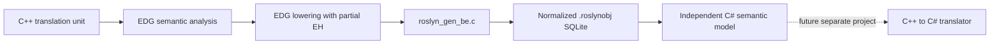

# EDG semantic tree and `.roslynobj`: design for approval

Status: revised phases 1–2 design following the user's API and lowering feedback.
Implementation has not started. This design requires approval before phases 3–4.

**Accepted priority (2026-10-12):** prefer lowered execution and accept documented
limits on original-source queries, including the selected declaration at a
virtual-call site and declaration default arguments. Preserve source facts where
stock EDG retains them; do not reconstruct lost facts. This decision resolves the
fidelity tradeoff; approval of the implementation plan remains pending.

## Scope and authority

Create a new EDG backend, `roslyn_gen_be.c`, that serializes the semantic
representation of one translation unit into normalized SQLite, and an independent
C# library that reads it. The eventual C++-to-C# translator is a separate future
project; neither the backend nor the model emits C# in these phases.

EDG alone decides C++ semantics. The backend projects its decisions; the reader
loads them. Neither repeats name lookup, overload resolution, template selection,
constant evaluation, layout, or lifetime analysis. Mechanical representation
changes, database identities, and traversing EDG-provided relationships are allowed.

The investigation uses a fresh checkout of upstream
[`edgcpp/compiler@89e67e07c7f6d0fc38622f9778d8e79f40deaa0f`](https://github.com/edgcpp/compiler/tree/89e67e07c7f6d0fc38622f9778d8e79f40deaa0f),
the revision recorded by `../upstream-origin.json`. Its `src/version.h` identifies
EDG 7.0. The user subsequently authorized inspection of the direct C# backend's
configuration and emission code to reassess lowering. That comparison informs
the revised configuration; all claims about stock EDG still use pristine
upstream. The dotobj effort, its findings and its implementation remain excluded.
Existing worktree modifications are untouched. Upstream source citations in the
companion documents refer to the pinned revision, not modified local files.

## Decisions proposed for approval

1. Enable general EDG IL lowering for the main native C++ profile, using the
   direct backend's lowering set as the baseline. C++ object construction,
   destruction, virtual/member-pointer operations, allocation, range-for, and
   other difficult language transformations belong in EDG. Disable a lowering
   only when the residual managed transformation demonstrably needs no deep
   C++ knowledge. The detailed switch matrix is in the lowering document.
2. Use partial EH: `DO_FULL_PORTABLE_EH_LOWERING=0`, `GENERATE_EH_TABLES=1`.
   Preserve try/catch/throw and normalize EDG's generated cleanup tables/state
   operations. Do not generate setjmp/longjmp for C++ exceptions. Retain available
   lifetime records as descriptive metadata, without using descriptors freed by
   stock lowering or copying the direct backend's retention patch.
3. Store lowered execution and retained declaration/type/source relationships in
   one typed graph. The public API groups and traverses these naturally. It does
   not pretend to recreate source constructs or signatures discarded by EDG.
   No pre-lowering snapshot hook or second semantic pass is assumed.
4. Keep every retained executable definition and every retained declaration/type
   definition in the translation unit, including header entities and unused
   definitions. Add their transitive semantic dependencies. Do not prune using
   a guessed future program entry point or only EDG's code-emission flags.
5. Keep template definitions/origins and concrete instantiations distinct.
   Dependent patterns are not execution-ready instantiations. Do not force EDG
   to instantiate unused templates just to make a database look complete.
6. Use only normalized scalar/foreign-key columns and ordered child rows.
   Intern names and literal values; never merge entities merely because their
   spelling or value matches. No JSON, BLOB semantic payloads, binary structs,
   encoded struct dumps, or lists packed into text columns.
7. Provide an immutable, high-level Roslyn-inspired C# API with no
   Microsoft.CodeAnalysis dependency. Ordinary navigation follows objects and
   collection properties: `unit.Functions`, `method.Parameters`, `type.Members`,
   `type.TypeArguments`, and `type.OriginalDefinition`. Database IDs are an
   internal detail. Missing/unsupported collections are empty; singular optional
   relationships use null/optional values. Detailed retention status is optional
   metadata, not a wrapper required for every access.
8. Keep translation units separate when opening multiple objects; linking and
   cross-unit deduplication remain deferred. Retain EDG source positions and
   available macro records by default. Full token
   tapes, comments, exact argument tokens, and token-paste lineage are not
   promised: ordinary retained IL does not provide them. Source coordinate kinds
   and availability are explicit.
9. Cover the full language surface the pinned upstream can accept, including its
   enabled GNU/Microsoft and other extensions. This requires a build/runtime
   profile matrix, not a claim that one combination enables incompatible EDG
   modes. A missing exporter adapter is an implementation gap, never permission
   to silently omit a successful input's semantic data.
10. Build from a pristine pinned upstream staging tree. Changes are limited to
    build configuration/backend registration, SQLite integration, and new
    backend/library files. No modifications to EDG's semantic implementation.

## Reading order

- [Lowering and integration](lowering-and-integration.md): exact upstream knobs,
  backend boundary, language profiles, and integration constraints.
- [Semantic inventory](semantic-inventory.md): EDG node families, C-generator
  coverage, semantic dependencies, and facts to retain.
- [Relational contract](relational-contract.md): table families, keys,
  normalization, exact values, reachability, and storage policy.
- [C# API and provenance](api-and-provenance.md): model, query examples,
  traversal, ownership, source positions, and macro limitations.
- [Implementation and acceptance](implementation-plan.md): ordered milestones,
  parallel work ownership, tests, and commit/approval gates.

## What “enough information” means

The object preserves the successful translation unit's retained EDG executable
IL and the semantic dependencies needed to interpret it at the chosen stage.
It does not promise an already assembled native executable, machine-code CFG,
or the semantics of every possible future template instantiation.

For example, a range-for is represented by the ordinary loop and iterator
operations EDG produces. Allocation records/calls use EDG's selected routines,
size/cookie calculations and initialization code where lowering supplies them.
Normal-path destructor calls and exceptional cleanup regions are separate
execution facts; the library reads their relationships without solving C++
lifetime rules again. C# rendering, CLR unwinding and symbolic storage access are
future consumer work based on those decisions.

Some boundaries remain substantial. EDG does not completely lower coroutine
frames, and certain accepted dialects cannot use its general lowering. Preserve
their semantic forms through explicit compatibility profiles and report the
remaining translator work as difficult, not as an easy C# implementation.
Source-name/type/member/origin retention after lowering must be documented
within the accepted source-query limits: the model must not invent an original signature, selected source overload,
default argument or syntax tree that the stock backend boundary no longer has.
In particular, `lower_virtual_function_call` replaces the `enk_routine` that
identified the selected method with a new indirect-call operation
(`src/lower_il.c:12524–12542`). Preserving the resulting call faithfully does not
preserve that source-selected declaration. This is a known fidelity loss, not
an implementation probe expected to recover the same link by enabling a flag.

Known absence, inapplicability, dependent information, a disabled retention option,
and an exporter implementation gap are different states. In particular, an
unimplemented required payload prevents publishing a complete object. Optional
metadata uses null/empty collections in ordinary navigation; callers who need
the reason can inspect capabilities and retention metadata separately.

## Approval boundary

Approval authorizes implementing this contract through the milestones in
[implementation-plan.md](implementation-plan.md). It does not authorize EDG core
changes, cross-TU linking, or the translator. Material discoveries that require
changing the approved representation, rather than filling in its documented
adapter details, return to design review.
